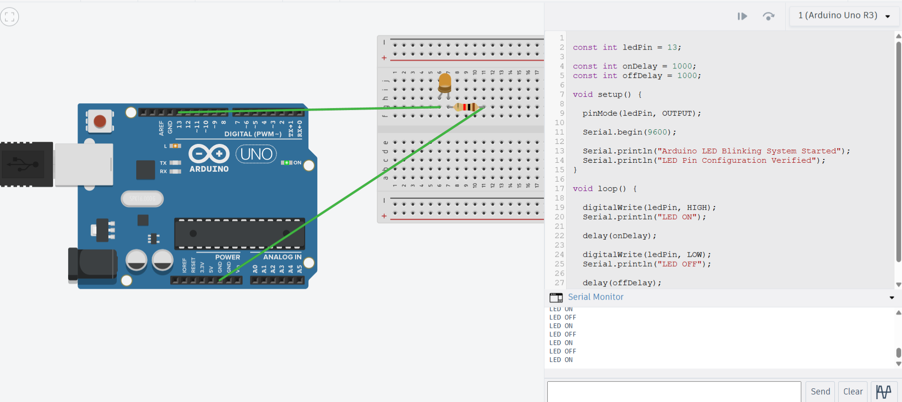

# GITHUB-BASED QA DOCUMENTATION AND PROBLEM SOLVING

## 1. Project Information

**Project Name:** Arduino LED Blinking System

**Platform:** GitHub

**Microcontroller:** Arduino Uno

**Programming Language:** Arduino C/C++

**Activity:** GitHub-Based QA Documentation and Problem Solving

## 2. GitHub Repository Link

Repository: https://github.com/KKAusl/Arduino-LED-Blinking-QA

## 3. Brief Description of Code

The Arduino LED Blinking System is a basic embedded system project that demonstrates digital output control using an Arduino Uno.

The LED is connected to digital pin 13 and is programmed to turn ON and OFF at one-second intervals.

Serial communication is also implemented to display LED status messages through the Serial Monitor.

## 4. QA Issues Logged

Four QA issues were identified and documented using GitHub Issues.

1. Incorrect LED Pin Configuration
2. Missing LED Pin Initialization
3. LED Blinking Delay Optimization
4. Missing Serial Monitoring for Debugging

Each issue includes a problem description, expected behaviour, actual behaviour, root cause analysis and proposed solution.

## 5. Solution Implementation

The following improvements were incorporated into the Arduino program:

- Centralized LED pin configuration.
- Explicit OUTPUT initialization.
- Standardized ON and OFF delay values.
- Added Serial Monitor debugging messages.

## 6. Collaboration Summary

GitHub collaboration features were used throughout the project.

- GitHub Issues were used to identify and track problems.
- Comments were added to discuss proposed solutions.
- Commits were used to record source code changes.
- A separate branch named qa-improvements was created.
- A Pull Request (#5) was created to review and merge testing documentation.
- GitHub Wiki was used to maintain project documentation.

## 7. Testing and Verification

Four test cases were documented:

- LED pin configuration.
- GPIO output initialization.
- LED blinking delay.
- Serial Monitor output.

Hardware testing is required to confirm the actual results.

## 8. Project Planning and Tracking

| Task | Status |
|---|---|
| Repository Creation | Completed |
| Arduino Code Upload | Completed |
| QA Issue Identification | Completed |
| Root Cause Documentation | Completed |
| Code Improvements | Completed |
| Branch Creation | Completed |
| Pull Request | Created |
| GitHub Wiki | Completed |
| Hardware Testing | Pending |
| Final Documentation | In Progress |

## 9. Learning Outcomes

Through this activity, I learned:

- How to create and manage GitHub repositories.
- How to identify and document software issues.
- How to perform root cause analysis using the 5-Why technique.
- How to maintain source code using commits and branches.
- How to create and manage Pull Requests.
- How to use GitHub Wiki for technical documentation.
- How collaborative tools improve project transparency and traceability.

## 10. Conclusion

This activity provided practical experience in using GitHub as a collaborative project management and quality assurance platform.

It demonstrated how issues can be identified, documented, analysed and tracked while maintaining proper project documentation and version control.

## 11. Hardware Simulation and Verification

The Arduino LED Blinking System was successfully tested using Tinkercad Circuits with an Arduino Uno R3.

The simulation verified the following:

- Correct LED pin configuration.
- Successful LED pin initialization.
- LED blinking with 1000 ms ON and OFF delays.
- Successful Serial Monitor communication at 9600 baud.
- Correct display of LED ON and LED OFF messages.

### Simulation Evidence

### Final Testing Result

All four documented test cases were successfully verified through simulation.

**Overall Status: PASS**

The simulation verifies LED blinking operation and Serial Monitor debugging.

### Tinkercad Circuit and Testing Output

